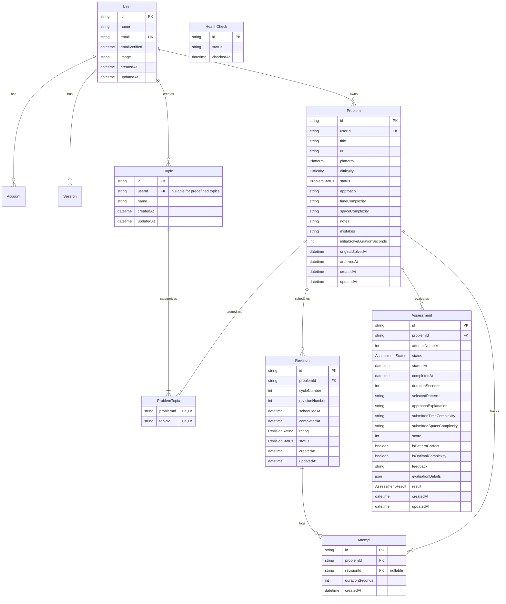

# Database Schema Documentation

DSA Revision and Mastery Platform database architecture powered by PostgreSQL and Prisma ORM.

---

## 1. Entity-Relationship Diagram



---

## 2. Entity Overview

### `User`
- Central identity record representing developers on the platform.
- Fully compatible with Auth.js (NextAuth.js v5) Prisma Adapter requirements.
- Standard companion tables: `accounts`, `sessions`, and `verification_tokens`.

### `Problem`
- Represents a discrete DSA problem saved by a developer (e.g. from LeetCode, HackerRank, GeeksforGeeks).
- Belongs strictly to one `User`.
- Retains initial solve performance (`initialSolveDurationSeconds`) and immutable solve baseline (`originalSolvedAt`).
- Supports soft archiving via `archivedAt` timestamp.

### `Topic` & `ProblemTopic`
- Categorization tags (e.g., "Sliding Window", "Dynamic Programming", "Heap").
- Predefined system topics feature `userId = null` (globally accessible).
- Custom user-created topics store `userId`, guaranteeing private categorization options.
- Linked to `Problem` through the explicit join table `ProblemTopic` (`@@id([problemId, topicId])`).

### `Revision`
- Scheduled spaced repetition review events on the mastery curve.
- Tracks `cycleNumber`, `revisionNumber`, `scheduledAt`, `completedAt`, `rating`, and `status`.
- Guarantees uniqueness per problem, cycle, and step: `@@unique([problemId, cycleNumber, revisionNumber])`.

### `Attempt`
- Performance metric log capturing every hands-on coding or recall effort.
- Stored independently from revision scheduling with exact `durationSeconds`.
- Optionally linked to a `revisionId` (`onDelete: SetNull`).

### `Assessment`
- Formal mastery assessment test sessions evaluating problem understanding without notes.
- Stores qualitative answers (`approachExplanation`, `selectedPattern`, complexities) and quantitative evaluation details (`score`, `isPatternCorrect`, `isOptimalComplexity`, `evaluationDetails` JSON).
- Retains retake attempts via unique `@@unique([problemId, attemptNumber])`.

### `HealthCheck`
- Infrastructure diagnostic record queried by `GET /api/health` to verify runtime database connectivity and latency.

---

## 3. Relationships & Referential Actions

| Relation | Parent | Child | Action on Parent Delete | Reason |
| :--- | :--- | :--- | :--- | :--- |
| User $\to$ Problems | `User` | `Problem` | `Cascade` | User account deletion purges user-owned problems |
| User $\to$ Custom Topics | `User` | `Topic` | `Cascade` | Deletes user-defined tags; predefined tags remain untouched |
| Problem $\to$ ProblemTopic | `Problem` | `ProblemTopic` | `Cascade` | Cleans up tag associations without deleting topics |
| Topic $\to$ ProblemTopic | `Topic` | `ProblemTopic` | `Cascade` | Untags problems when topic is removed; leaves problems intact |
| Problem $\to$ Revisions | `Problem` | `Revision` | `Cascade` | Revision schedule belongs directly to the problem |
| Problem $\to$ Attempts | `Problem` | `Attempt` | `Cascade` | Attempts belong directly to the problem |
| Revision $\to$ Attempts | `Revision` | `Attempt` | `SetNull` | **Critical**: Pruning or cancelling a revision never destroys attempt solve logs |
| Problem $\to$ Assessments | `Problem` | `Assessment` | `Cascade` | Assessment records belong directly to the problem |

---

## 4. Revision Cycle Mechanics & Spaced Repetition Design

The platform applies a spaced repetition curve anchored to the problem's solve date:

$$\text{Intervals: } \text{Day 1, 3, 7, 15, 30, 60, 90, 120, and every 30 days thereafter}$$

### Mechanics

1. **Cycle Preservation (`cycleNumber`)**:
   - Every revision belongs to a `cycleNumber` (starts at `1`).
   - If a developer selects rating `FORGOT` or `DIFFICULT`:
     - The current revision is marked `status: COMPLETED` with its rating.
     - A new revision cycle is initiated with `cycleNumber = cycleNumber + 1`.
     - The first revision (`revisionNumber = 1`) in the new cycle is scheduled for **Tomorrow** ($\text{scheduledAt} = \text{now} + 1 \text{ day}$).
     - Past cycle revisions remain fully preserved in history for progress analytics.
2. **Advancing Revisions (`GOOD` / `EASY`)**:
   - Advances to `revisionNumber + 1` along the spaced repetition curve.
3. **Overdue Handling**:
   - Revisions scheduled in the past that have not been completed retain `status: PENDING`.
   - Missed revisions are **never automatically skipped or deleted**.
   - Completing an overdue revision does **not** shift future scheduled dates forward unless a cycle restart occurs.

---

## 5. Distinction: Revision vs. Attempt

| Attribute | `Revision` | `Attempt` |
| :--- | :--- | :--- |
| **Concept** | Scheduled milestone on the spaced repetition calendar | Concrete solving session performance log |
| **Occurrence** | Pre-generated or scheduled in advance | Created whenever the user practices or tests |
| **Optionality** | Must follow schedule intervals | Can occur inside or outside a revision |
| **Preservation** | Retains lifecycle state (`PENDING`, `COMPLETED`, `CANCELLED`) | Immutable historical timing log (`durationSeconds`) |
| **Deletion Safety** | If pruned or cancelled, linked `Attempt` rows set `revisionId = null` | Never deleted unless the parent problem is deleted |

---

## 6. Distinction: Assessment vs. Mastery

- **Assessment (`assessments` table)**:
  - An active test session where the developer proves problem mastery under time constraints without viewing solution notes.
  - Can be retaken multiple times (`attemptNumber = 1, 2, 3...`).
  - Evaluates pattern recognition (`selectedPattern`), complexity correctness (`isOptimalComplexity`), and test case pass rates (`score`).
  - Produces outcome `MASTERY_ACHIEVED` or `NEEDS_IMPROVEMENT`.
- **Mastery Status**:
  - Mastery is **never automatically conferred** merely by passing four revisions.
  - A problem transitions to `status = MASTERED` only after successful assessment criteria or explicit mastery qualification.

---

## 7. Archiving Behavior

- Soft archive is implemented via `Problem.archivedAt` (`DateTime?`).
- Active problems query `WHERE archived_at IS NULL`.
- Archived problems query `WHERE archived_at IS NOT NULL`.
- Archiving a problem preserves all related `revisions`, `attempts`, `assessments`, and `problem_topics` in their exact state.
- Restoring a problem simply sets `archivedAt = null`.

---

## 8. Important Constraints & Indexes

### Unique Constraints
- `users(email)`: Prevents duplicate user accounts.
- `topics(user_id, name)`: Prevents duplicate topic names for a single user while allowing distinct users to define identical custom topic names.
- `problem_topics(problem_id, topic_id)`: Composite primary key preventing duplicate topic tagging.
- `revisions(problem_id, cycle_number, revision_number)`: Guarantees unique revision sequence ordering within each revision cycle.
- `assessments(problem_id, attempt_number)`: Guarantees ordered, non-conflicting assessment attempts.

### Performance Indexes
- Frequent filter criteria: `problems(user_id, archived_at)`, `problems(difficulty)`, `problems(platform)`.
- Workspace query lookups: `revisions(scheduled_at, status)`, `revisions(problem_id, status)`.
- Analytics & solve time queries: `attempts(problem_id, created_at)`.

---

## 9. Migration Commands

```bash
# Apply pending migrations to the development database
pnpm prisma:migrate

# Deploy migrations in CI/CD or production environments
pnpm prisma:migrate:deploy

# Regenerate Prisma Client types
pnpm prisma:generate

# Launch Prisma Studio browser UI
pnpm prisma:studio
```

